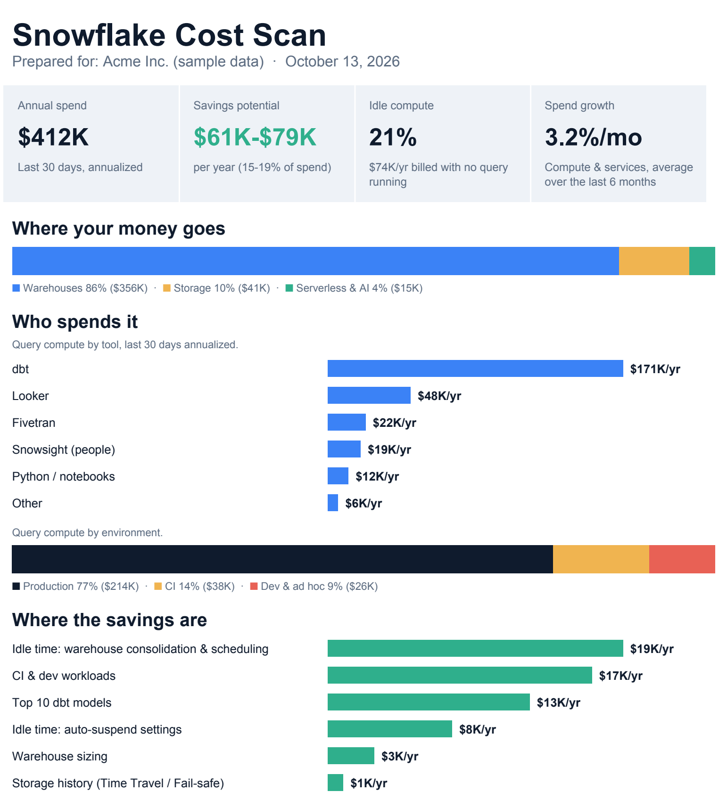

# Snowflake Cost Scan

Find out where your Snowflake money goes, and roughly how much of it you could save, in about two minutes.

One read-only SQL script. No installs, no account access for anyone else, no data leaves your account unless you choose to share the result.

[](examples/sample_report.pdf)

*Sample output on made-up data. [Full 2-page report (PDF)](examples/sample_report.pdf).*

## What it tells you

| Section | What you get |
|---|---|
| Summary | Annual spend, savings range, idle compute %, monthly growth |
| Spend mix | Warehouses vs storage vs serverless & AI |
| By tool | Query compute from dbt, Looker, Fivetran, Airbyte, Sigma, Tableau, Power BI, Hex, Airflow, Snowsight, Python and more |
| By environment | Production vs CI vs dev & ad hoc |
| Top dbt models | Your 10 most expensive models, per year |
| Idle warehouses | Your 5 warehouses with the most credits billed while no query ran |
| Focus areas | Estimated annual savings for idle time, sizing, CI & dev, top models and storage history |
| Trend | Monthly spend for the last 6 months |

Prices come from your contract rate sheet when your role can see it, otherwise from list price. You can override both at the top of the script.

## How to run it

1. Open a Snowsight worksheet as `ACCOUNTADMIN`, or any role with `IMPORTED PRIVILEGES` on the `SNOWFLAKE` database.
2. Pick a Small or Medium warehouse.
3. Paste [`scan.sql`](scan.sql) and run it. Large accounts take about 2 minutes.
4. Download the result as CSV.

## Turn it into a PDF (optional)

```bash
pip install -r report/requirements.txt
python report/scan_report.py scan.csv "Your Company" report.pdf
```

See [`examples/sample_report.pdf`](examples/sample_report.pdf) for what it looks like (made-up data).

## What it reads, and what it doesn't

- **Reads:** `SNOWFLAKE.ACCOUNT_USAGE` views (metering, query history, query attribution, sessions, table storage), `SHOW WAREHOUSES`, and `ORGANIZATION_USAGE.RATE_SHEET_DAILY` if visible.
- **Never reads:** your tables or any business data.
- **Changes nothing:** no tables, no warehouses, no settings.
- **Query text** is scanned inside your account only to detect dbt and BI tool comments. It is never part of the output.
- **The output** contains spend totals, warehouse names, dbt model names and tool labels. Review it before you share it.

## How the savings are estimated

These are planning estimates, not invoice guarantees.

| Focus area | Assumption |
|---|---|
| Idle time: auto-suspend | Idle credits shrink in proportion when `AUTO_SUSPEND` drops to 60s |
| Idle time: consolidation & scheduling | 30% of idle time left at short auto-suspend is recoverable |
| Warehouse sizing | 25% of query credits on Medium+ warehouses where 90% of queries finish in under 10s with no spill |
| CI & dev workloads | 30% of CI and dev query compute |
| Top 10 dbt models | 20% of their compute (incremental loads, materialization, clustering) |
| Storage history | Half of Time Travel and Fail-safe storage |

The high end of the range adds 5% of warehouse spend for query tuning the scan doesn't measure.

## Want the fixes, not just the findings?

The scan shows where the money goes. A full Metricgrain cost audit shows why, prices every fix in dollars per year, ranks them by payback, and applies the quick wins with you.

Send your scan CSV to **hello@metricgrain.com** for a free 30-minute walkthrough.

## License

MIT, see [LICENSE](../LICENSE).
